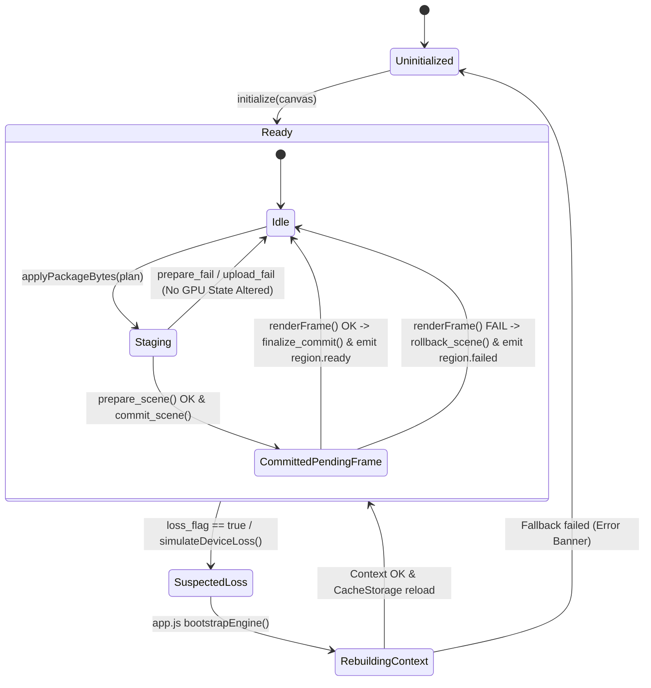

# ADR 005: Transacción GPU de Dos Fases, Rollback Atómico y Recuperación Ante Pérdida de Dispositivo

## Estado
Aceptado / Implementado (M04-H Hardening)

## Contexto
Durante la auditoría técnica independiente de M04 (`docs/AUDITORIA_IMPLEMENTACION_03.md`), se evidenciaron limitaciones críticas en el ciclo de vida de los recursos GPU:
1. Las cargas de geometría destruían de forma prematura los buffers de la escena previa antes de verificar la presentación efectiva del primer frame renderizado.
2. Si la GPU fallaba durante la subida o en el primer draw call, el motor quedaba en un estado visual corrupto o inconsistente (pantalla negra, handles huérfanos).
3. Los callbacks nativos de pérdida de dispositivo de `wgpu` (`wgpu::Device::set_device_lost_callback`) no estaban cableados directamente al runtime de WebAssembly, impidiendo una detección determinista.
4. Las pruebas de recuperación dependían de conmutaciones artificiales en JavaScript sin un protocolo atómico de dos fases en el core de Rust.

## Decisión de Diseño

### 1. Swap GPU Transaccional de Dos Fases (M04-H1)
Se desacopló la preparación de buffers GPU de la destrucción de recursos activos en `atlas-core::renderer::Renderer`:

- **Fase 1: Preparación (`prepare_scene(&Scene) -> Result<GpuSceneResources, EngineError>`)**:
  - Asigna buffers de vértices e índices para la escena candidata en memoria GPU (`wgpu::BufferUsages::VERTEX`, `INDEX`, `COPY_DST`).
  - No altera `active_scene_resources` ni el estado de la cámara ni los 26 nodos de la escena activa.
  - Si ocurre un fallo de asignación, fallo de shader o failpoint inyectado (`prepare_fail`, `upload_fail`), los recursos candidatos se purgan inmediatamente mediante llamadas explícitas a `buffer.destroy()` y la escena activa permanece 100% intacta.

- **Fase 2: Commit Transaccional (`commit_scene(GpuSceneResources)`)**:
  - Mueve los recursos activos actuales a `retiring_scene_resources`.
  - Instala los recursos candidatos en `active_scene_resources`.
  - Conserva una copia de la escena CPU previa en `inner.rollback_scene`.
  - No destruye `retiring_scene_resources` hasta que el primer frame es presentado exitosamente.

- **Finalización de Commit (`finalize_commit() -> usize`)**:
  - Se ejecuta exclusivamente en `renderFrame()` tras `queue.present(output)`.
  - Destruye explícitamente los buffers de `retiring_scene_resources` liberando memoria GPU.
  - Limpia `inner.rollback_scene = None`.

- **Rollback Atómico (`rollback_scene()`)**:
  - Si `renderFrame()` falla (o se dispara el failpoint `first_render_fail`), `rollback_scene()` descarta los recursos candidatos fallidos, restaura los buffers de `retiring_scene_resources` en `active_scene_resources` y restaura la escena CPU desde `inner.rollback_scene`.
  - Los 26 nodos anatómicos, la selección activa y la orientación de la cámara permanecen inalterados.

### 2. Detección y Recuperación de Pérdida de Dispositivo GPU (M04-H4)
- Se integró `loss_flag: Arc<AtomicBool>` en `AtlasEngine` inicializado y enlazado a `wgpu::Device::set_device_lost_callback`.
- Si el driver o el navegador destruyen el contexto GPU, el callback activa `loss_flag`.
- `renderFrame()` inspecciona `loss_flag.load(Ordering::SeqCst)` antes de someter trabajo a la GPU. Si detecta pérdida:
  - Transiciona el ciclo de vida a `EngineLifecycleState::SuspectedLoss`.
  - Emite el evento `device.recovering`.
  - Detiene inmediatamente las llamadas a `queue.submit()` para prevenir pánicos del runtime.
- El shell de aplicación (`app.js`) orquesta la reconstrucción limpia:
  - Reemplaza el elemento `<canvas>` del DOM para desasociar el contexto WebGPU/WebGL2 muerto.
  - Reinstancia `AtlasEngine` en el backend preferido (con fallback automático de WebGPU a WebGL2 si WebGPU no logra re-inicializarse).
  - Recarga la región y LOD activos desde `CacheStorage` verificado en disco (cero llamadas de red).
  - Emite `device.recovered` y `region.ready`.

## Diagrama de la Máquina de Estados

## Consecuencias
- **Garantías Anatómicas**: Es imposible que un error de red o de GPU degrade las 26 estructuras TA2 a un estado nulo o vacío sin levantar una excepción recuperable.
- **Transparencia en Pruebas**: Los failpoints controlados (`prepare_fail`, `upload_fail`, `first_render_fail`) permiten verificar regresiones en CI sin depender de errores probabilísticos de hardware.
- **Límites Documentados**: La simulación de pérdida de dispositivo se ejecuta mediante `wgpu::Device::destroy()`. Los fallos físicos del driver a nivel del sistema operativo se clasifican explícitamente como `PHYSICAL_DRIVER_LOSS = NOT_RUN`.
