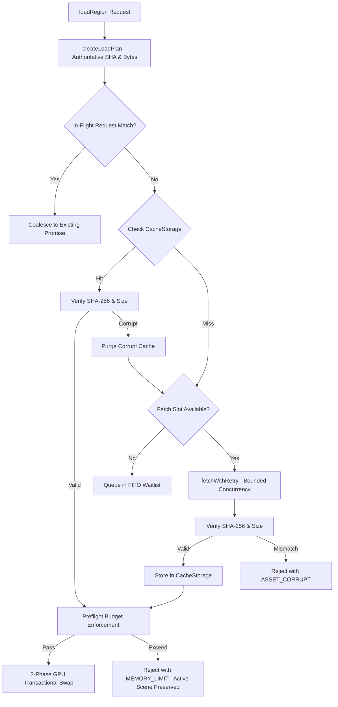

# ADR 006: Control Preflight de Memoria, Contabilidad de Overlap y Scheduler Acotado de Transporte

## Estado
Aceptado / Implementado (M04-H Hardening)

## Contexto
En la auditoría independiente (`docs/AUDITORIA_IMPLEMENTACION_03.md`), se identificaron varias brechas de confiabilidad en la capa de memoria y transporte:
1. Las métricas de memoria reportadas por el runtime no diferenciaban con rigor entre la memoria VRAM física del driver (la cual no es medible directamente desde WebGPU/WebGL2 en navegadores sin extensiones propietarias) y las estimaciones analíticas de buffers alojados.
2. No existía un control preflight del presupuesto de memoria (`preflight_swap_budget`) que previniese la saturación de memoria durante el solapamiento transaccional de dos escenas simultáneas en GPU.
3. El módulo de transporte en JavaScript carecía de un planificador con cupos acotados de concurrencia, lo que permitía ráfagas incontroladas de peticiones de red si el usuario conmutaba rápidamente entre perfiles o regiones.
4. Las peticiones concurrentes idénticas no implementaban coalescing, provocando descargas redundantes del mismo binario GLB.

## Decisión de Diseño

### 1. Perfiles de Calidad y Presupuestos Reales (M04-H2)
Se formalizaron tres perfiles estandarizados en `atlas-core::memory::QualityProfile`:
- **Low**:
  - `gpu_resident_budget_bytes`: 64 MiB (67,108,864 B)
  - `cpu_decoded_budget_bytes`: 48 MiB (50,331,648 B)
  - `max_concurrent_fetches`: 2 peticiones simultáneas
- **Medium** (Default):
  - `gpu_resident_budget_bytes`: 128 MiB (134,217,728 B)
  - `cpu_decoded_budget_bytes`: 96 MiB (100,663,296 B)
  - `max_concurrent_fetches`: 3 peticiones simultáneas
- **High**:
  - `gpu_resident_budget_bytes`: 256 MiB (268,435,456 B)
  - `cpu_decoded_budget_bytes`: 160 MiB (167,772,160 B)
  - `max_concurrent_fetches`: 4 peticiones simultáneas

### 2. Comprobación Preflight de Presupuesto (`preflight_swap_budget`)
Antes de iniciar cualquier decodificación intensiva o asignación de buffers en GPU:
- Se evalúa el pico de solapamiento transaccional:
  $$\text{Peak GPU} = \text{Resident Active GPU} + \text{Candidate GPU} + \text{Depth RenderTarget}$$
  $$\text{Peak CPU} = \text{Decoded Active CPU} + \text{Candidate Decoded CPU}$$
- Si $\text{Peak GPU} > \text{Budget GPU}$ o $\text{Peak CPU} > \text{Budget CPU}$, `preflight_swap_budget` rechaza la operación inmediatamente con `ErrorCode::MemoryLimit` y `recoverable: true`.
- **Invariante**: El recurso activo existente NUNCA se destruye para dar paso a un candidato que excedería el presupuesto.

### 3. Contabilidad de Memoria Explícita
Para evitar reclamos falsos de "medición física de VRAM", el runtime expone un desglose transparente:
- `gpu_buffer_allocated_estimate`: Bytes exactos alojados en vertex/index buffers en GPU.
- `gpu_depth_render_target_estimate`: Bytes del render target de profundidad ($W \times H \times 4$).
- `resident_gpu_bytes_estimate`: Suma de buffers + profundidad + uniformes de cámara.
- `peak_overlap_bytes_estimate`: Marca máxima alcanzada durante el intercambio de dos escenas.
- `cpu_scene_decoded_estimate`: Memoria heap consumida por las estructuras CPU.
- `accounting_mode`: `"GPU_ALLOCATION_ESTIMATE_ONLY"`
- `physical_driver_vram`: `"PHYSICAL_VRAM_NOT_MEASURED"`

### 4. Scheduler Acotado de Transporte y Coalescing (M04-H5)
Se extrajo el planificador a un módulo ES independiente (`apps/probe-web/asset-stream-manager.js`):
- **Cupos de Concurrencia**: Acotados por perfil (2, 3 o 4 slots activos). Las peticiones excedentes se encolan en una cola FIFO estructurada.
- **Request Coalescing**: Si se solicita un paquete cuyo URL y SHA-256 ya están en vuelo (`inFlightRequests.has(cacheKey)`), la nueva petición se adjunta a la promesa existente en lugar de abrir una conexión de red adicional.
- **Reintentos con Backoff Exponencial y Jitter**: En caso de códigos transitorios de error HTTP (408, 429, 500, 502, 503, 504), se ejecutan hasta 2 reintentos con intervalo $200 \times 2^{\text{attempt}} + \text{rand}(100)\text{ ms}$.
- **Caché en Disco**: `CacheStorage` almacena paquetes GLB verificados con clave canónica `https://atlas.local/assets/{version}/{packageId}?sha={sha256}`.

### 5. App Shell Offline vía Service Worker (M04-H6)
- Se implementó `apps/probe-web/service-worker.js` para precachear el shell estático: `index.html`, `app.js`, `asset-stream-manager.js`, `structures.json` y los binarios WASM (`pkg-webgpu`, `pkg-webgl2`).
- Para los paquetes GLB, el Service Worker y el `AssetStreamManager` consultan `CacheStorage` verificado.
- Esto permite una recarga auténtica `page.reload()` desconectado de la red (`RELOADED_OFFLINE`), verificada bajo Playwright sin simulaciones artificiales.

## Diagrama de Flujo del Transporte

## Consecuencias
- Cero fugas de descriptores de socket o peticiones redundantes.
- Cumplimiento estricto de presupuestos de memoria en dispositivos móviles y laptops con memoria unificada.
- Integridad criptográfica innegociable de extremo a extremo.
