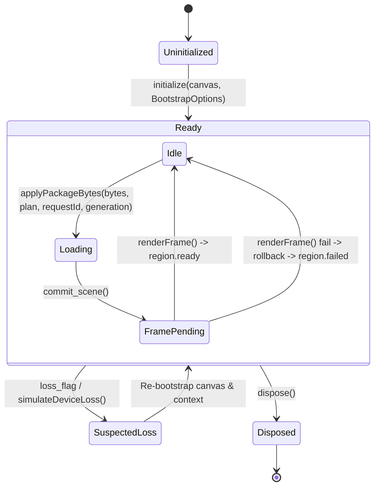

# Contrato de Puente en Tiempo de Ejecución (WASM ↔ JS Bridge Contract)

**Versión del Contrato:** 1.1.0 (M04-H Runtime Hardening)  
**Compatibilidad:** Rust `wgpu 30.0.1`, WebGPU, WebGL2, TypeScript / ES2022

---

## 1. Ciclo de Vida del Motor (`AtlasEngine`)

### 1.1 Estados del Ciclo de Vida



| Estado | Descripción | Transición Válida |
| :--- | :--- | :--- |
| `Uninitialized` | Instancia creada pero sin contexto GPU ni canvas vinculado. | `initialize()` -> `Ready` |
| `Ready` | Pipeline y superficie activos; listo para interactuar o renderizar. | `applyPackageBytes()`, `dispose()`, pérdida de GPU |
| `StagingSwap` | Swap transaccional en progreso (Fase 1 completada, escena candidata comprometida en GPU). | `renderFrame()` presenta frame -> `Ready` |
| `SuspectedLoss` | Callback de pérdida de dispositivo activado; work submission detenido. | Reconstrucción de contexto -> `Ready` |
| `Disposed` | Recursos GPU destruidos explícitamente (`buffer.destroy()`); handles liberados. | Terminal. No se emiten más eventos. |

---

## 2. API de Métodos Exportados (`AtlasEngine`)

### 2.1 Inicialización y Configuración
```typescript
class AtlasEngine {
  constructor();

  /**
   * Inicializa la superficie gráfica en el canvas HTML indicado.
   * Devuelve las capacidades efectivas del adaptador y backend negociado.
   */
  initialize(
    canvas: HTMLCanvasElement,
    options?: BootstrapOptions
  ): Promise<EngineCapabilities>;

  /**
   * Carga el manifiesto canónico inmutable en el motor Rust.
   */
  loadManifest(manifestJson: string): ManifestSnapshot;

  /**
   * Define el callback unificado de eventos de ciclo de vida e interacción.
   */
  setEventCallback(callback: (event: EngineEvent) => void): void;

  /**
   * Inyecta failpoints controlados para pruebas de confiabilidad adversarial.
   * Valores soportados: "none", "prepare_fail", "upload_fail", "first_render_fail".
   */
  setTestFailpoint(name: string): void;

  /**
   * Ajusta el perfil de calidad activo ("low", "medium", "high").
   * Ejecuta preflight budget check contra la escena activa.
   */
  setQualityProfile(profile: "low" | "medium" | "high"): QualityBudget;

  /**
   * Libera determinísticamente todos los recursos y listeners GPU.
   */
  dispose(): void;
}
```

### 2.2 Swap Transaccional y Carga de Paquetes
```typescript
interface RegionLoadPlan {
  region_id: string;
  variant_id: string;
  lod: number;
  package_id: string;
  package_url: string;
  expected_package_bytes: number;
  expected_package_sha256: string;
}

interface ApplyResult {
  region: string;
  variant: string;
  lod: number;
  selected_id: string | null;
  revision: number;
  total_nodes: number;
}

class AtlasEngine {
  /**
   * Crea un plan canónico de carga validado por el manifiesto inmutable.
   */
  createLoadPlan(
    regionId: string,
    variantId: string,
    preferredLod: number
  ): RegionLoadPlan;

  /**
   * Aplica un binario GLB verificado mediante swap transaccional de dos fases.
   * Emite `region.loading`. El evento `region.ready` se difiere hasta el primer frame presentado.
   */
  applyPackageBytes(
    bytes: Uint8Array,
    plan: RegionLoadPlan,
    requestId: number,
    generation: number
  ): ApplyResult;

  /**
   * Cancela una carga en curso e incrementa el token generacional.
   */
  cancelLoad(requestId?: number): number;

  /**
   * Obtiene el token generacional actual de la escena.
   */
  currentGeneration(): number;

  /**
   * Genera el siguiente token generacional asociado a un requestId.
   */
  nextGeneration(requestId?: number): number;
}
```

### 2.3 Renderizado y Control de Cámara
```typescript
class AtlasEngine {
  /**
   * Ejecuta el pase de renderizado bajo demanda.
   * Si hay un swap transaccional pendiente, presenta el frame, ejecuta finalize_commit()
   * y despacha `region.ready`. Si falla, ejecuta rollback_scene() y retorna false.
   */
  renderFrame(): boolean;

  /**
   * Solicita un nuevo frame para el siguiente ciclo de animación.
   */
  requestRender(): void;

  /**
   * Redimensiona la superficie y actualiza el aspect ratio de la cámara.
   */
  resize(width: number, height: number): void;

  /**
   * Rota la cámara en coordenadas esféricas (órbita).
   */
  orbit(deltaAzimuthRad: number, deltaPolarRad: number): void;

  /**
   * Desplaza el objetivo de la cámara en el plano de visión (pan).
   */
  pan(deltaX: number, deltaY: number): void;

  /**
   * Acerca o aleja la cámara (zoom).
   */
  zoom(factor: number): void;

  /**
   * Restablece la vista por defecto enfocando la escena activa.
   */
  resetCamera(): void;
}
```

### 2.4 Interacción Anatómica y Visibilidad
```typescript
class AtlasEngine {
  /**
   * Realiza raycasting exacto en coordenadas CSS del canvas.
   */
  selectAt(xCss: number, yCss: number): string | null;

  /**
   * Selecciona una estructura por su AnatomyId o deselecciona con null.
   */
  selectStructure(id: string | null): number;

  /**
   * Modifica la visibilidad de una estructura anatómica específica.
   */
  setVisibility(id: string, visible: boolean): number;

  /**
   * Aísla una estructura visible, ocultando el resto.
   */
  isolateStructure(id: string): number;

  /**
   * Restablece la visibilidad de todas las estructuras a true.
   */
  resetVisibility(): number;

  /**
   * Enfoca la cámara en la estructura especificada por su AABB.
   */
  focusStructure(id: string): boolean;
}
```

### 2.5 Métricas de Memoria y Telemetría
```typescript
interface MemoryStats {
  qualityProfile: "Low" | "Medium" | "High";
  residentGpuBytes: number;
  residentGpuBytesEstimate: number;
  gpuBufferAllocatedEstimate: number;
  gpuDepthRenderTargetEstimate: number;
  cpuSceneDecodedEstimate: number;
  cpuStagingBytesEstimate: number;
  verifiedBlobBytes: number;
  cacheStorageEstimate: number;
  peakOverlapBytesEstimate: number;
  gpuBudgetBytes: number;
  cpuBudgetBytes: number;
  isWithinBudget: boolean;
  evictionsCount: number;
  currentGeneration: number;
  activeRequestId: number | null;
  sceneRevision: number;
  rollbackCount?: number;
  preflightBudgetRejections?: number;
}

class AtlasEngine {
  /**
   * Devuelve el desglose riguroso de memoria estimada y estado de presupuestos.
   */
  getMemoryStats(): MemoryStats;

  /**
   * Devuelve las estadísticas de renderizado (nodos, primitivas, triángulos, draw calls).
   */
  getStats(): RenderStats;
}
```

---

## 3. Secuencia y Semántica de Eventos

### 3.1 Orden Canónico de Eventos en Swap de Región
1. `region.loading`: Emitido inmediatamente al iniciar `applyPackageBytes` tras validar plan y SHA-256.
2. *(Swap transaccional en GPU; preparación de buffers y commit staged)*.
3. Primer `renderFrame()` exitoso -> Frame presentado en swapchain (`queue.present(output)`).
4. `region.ready`: Emitido **estrictamente después** de presentar el primer frame.
5. `scene.changed`: Emitido inmediatamente tras `region.ready`.

```json
{
  "type": "region.ready",
  "requestId": 1,
  "sceneGeneration": 4,
  "sceneRevision": 4,
  "region": "pelvis",
  "variant": "male-adult",
  "lod": 1,
  "backend": "webgpu"
}
```

### 3.2 Semántica de Fallo y Rollback
- Si `applyPackageBytes` es rechazado en preflight (por memoria, hash o tamaño):
  - Se emite `engine.error`.
  - NUNCA se emite `region.ready`.
  - La escena activa anterior permanece intacta.
- Si `renderFrame()` falla en la fase de presentación:
  - Se ejecuta `rollback_scene()`.
  - Se emite `region.failed`.
  - Se emite `engine.error`.
  - NUNCA se emite `region.ready`.
  - La escena anterior es restaurada completamente en GPU y CPU.

---

## 4. Códigos de Error Normalizados (`ErrorCode`)

| Código | Significado | Recuperable | Acción Recomendada |
| :--- | :--- | :--- | :--- |
| `ASSET_CORRUPT` | Discrepancia en SHA-256, tamaño de archivo o GLB malformado. | Sí | Purgar `CacheStorage` y reintentar descarga limpia. |
| `REGION_UNAVAILABLE` | Región, variante o LOD no listado en el manifiesto canónico. | No | Corregir parámetros de petición de acuerdo al catálogo. |
| `MEMORY_LIMIT` | La escena candidata excede el presupuesto del perfil activo. | Sí | Conmutar a un LOD más simplificado o elevar el perfil de calidad. |
| `GPU_UNAVAILABLE` | Fallo al asignar buffers o shader compilation error. | Sí | Ejecutar rollback y mantener escena residente. |
| `CANCELLED` | Petición superada por una generación más reciente ("last wins"). | Sí | Descartar silenciosamente; procesar petición ganadora. |
